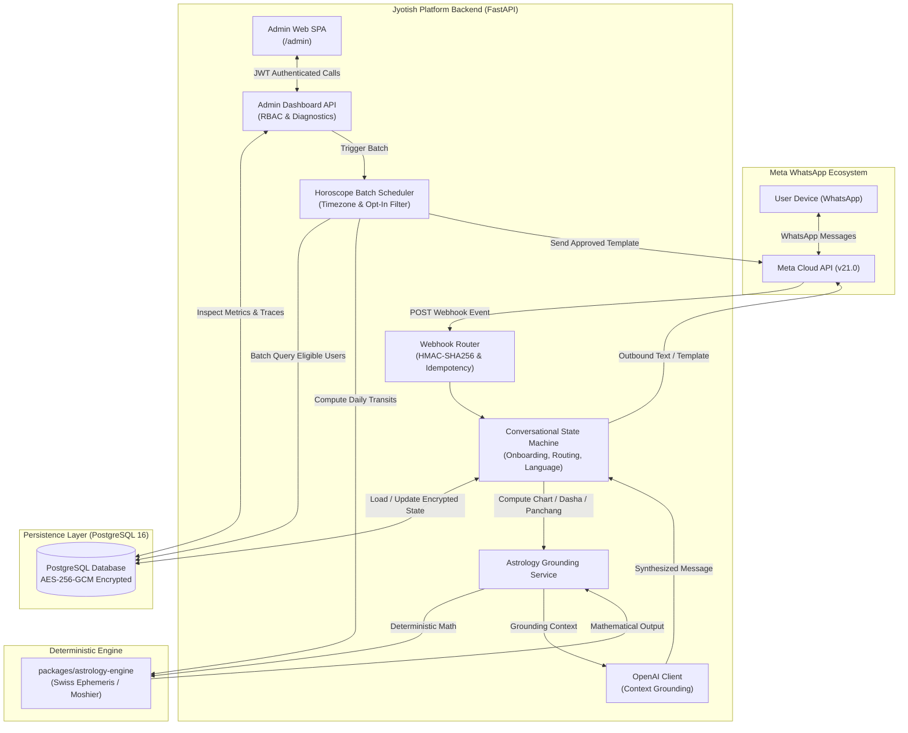

# Jyotish WhatsApp Assistant & Admin Console

> A production-oriented, privacy-preserving astrological assistant operating over the Meta WhatsApp Cloud API with an internal administration single-page dashboard and a deterministic astronomical calculation engine.

---

## Table of Contents

1. [Project Overview](#1-project-overview)
2. [Feature and Implementation Status](#2-feature-and-implementation-status)
3. [Technology Stack](#3-technology-stack)
4. [Architecture and Data Flow](#4-architecture-and-data-flow)
5. [Repository Structure](#5-repository-structure)
6. [Prerequisites](#6-prerequisites)
7. [Local Setup and Installation](#7-local-setup-and-installation)
8. [Environment Variables and Configuration](#8-environment-variables-and-configuration)
9. [Database and Data Model](#9-database-and-data-model)
10. [Astrology Engine](#10-astrology-engine)
11. [WhatsApp Integration](#11-whatsapp-integration)
12. [AI and Conversation Behavior](#12-ai-and-conversation-behavior)
13. [Admin Dashboard Guide](#13-admin-dashboard-guide)
14. [API Reference](#14-api-reference)
15. [Testing and Quality Checks](#15-testing-and-quality-checks)
16. [Scheduler and Background Jobs](#16-scheduler-and-background-jobs)
17. [Security, Privacy, and Licensing](#17-security-privacy-and-licensing)
18. [Deployment and Production Readiness](#18-deployment-and-production-readiness)
19. [Troubleshooting and Common Errors](#19-troubleshooting-and-common-errors)
20. [Developer Workflow and Contribution Guide](#20-developer-workflow-and-contribution-guide)
21. [Roadmap and Known Limitations](#21-roadmap-and-known-limitations)
22. [References and Related Documentation](#22-references-and-related-documentation)

---

## 1. Project Overview

The **Jyotish WhatsApp Assistant** is an asynchronous backend service and administration console that delivers personalized, accurate, and privacy-compliant astrological readings directly through WhatsApp.

### Target Audience & User Workflows
- **End Users (WhatsApp):** Users interact with a dedicated WhatsApp Business phone number. They complete an interactive onboarding flow (recording consent, birth date, time, and city), switch dynamically between Vedic (Lahiri/Chitrapaksha) and Western (Tropical) calculation frameworks, query on-demand insights (daily horoscope, current Vimshottari Dasha, Gochara transits, Shani Sade Sati, today's Panchang), perform relationship compatibility checks (Kundli Milan / Ashtakoota 36-point matching), and subscribe to automated daily horoscope dispatches.
- **Operations & Astrological QA Teams (`/admin`):** Internal operators sign in to an authenticated, minimalist flat 2D administration dashboard. They monitor real-time user engagement KPIs, inspect privacy-redacted conversation message traces, verify subsystem diagnostics (PostgreSQL, Swiss Ephemeris, OpenAI, Meta Graph API, AES-GCM encryption), and manually trigger idempotent daily horoscope batch dispatches.

### Core Philosophy
1. **Zero Hallucination Astronomical Grounding:** Large Language Models (LLMs) are **never** permitted to calculate or infer planetary degrees, nakshatras, house cusps, dashas, or compatibility scores. All calculations are executed deterministically by the Python calculation engine. The LLM acts solely as a natural language synthesizer grounded on verified mathematical data.
2. **Privacy-by-Design:** No plaintext phone numbers are ever persisted in application tables or written to server logs. Phone numbers are pseudonymized via HMAC-SHA256 and encrypted at rest with AES-256-GCM. Affirmative consent tracking (DPDP / GDPR) and atomic right-to-erasure cascade deletions are enforced at the persistence layer.

---

## 2. Feature and Implementation Status

| Feature / Subsystem | Functional Scope | Implementation Status | Relevant Path / Reference |
|:---|:---|:---|:---|
| **Deterministic Ephemeris Adapter** | Sidereal & Tropical planetary longitudes, speeds, houses, and Julian Day conversions | **Implemented** | `packages/astrology-engine/src/astrology_engine/adapter.py` |
| **Vedic D1 & Navamsa (D9)** | Natal chart computation, 27 Nakshatras, 108 Padas, Vargottama planet detection | **Implemented** | `packages/astrology-engine/src/astrology_engine/navamsa.py` |
| **Vimshottari Dasha Engine** | 120-year cycle breakdown starting from Moon Nakshatra balance, active Mahadasha & Antardasha lookup | **Implemented** | `packages/astrology-engine/src/astrology_engine/dasha.py` |
| **Vedic Panchang (5 Limbs)** | Real-time Tithi, Vara, Nakshatra, Yoga, and Karana (with Vishti / Bhadra flagging) | **Implemented** | `packages/astrology-engine/src/astrology_engine/panchang.py` |
| **Transits & Sade Sati** | Real-time Gochara positions, Saturn 12th/1st/2nd house Sade Sati phases (Rising, Peak, Setting) | **Implemented** | `packages/astrology-engine/src/astrology_engine/transits.py` |
| **Ashtakoota Compatibility** | 36-Guna matching across 8 Kootas with classical Nadi & Bhakoot dosha cancellations | **Implemented** | `packages/astrology-engine/src/astrology_engine/compatibility.py` |
| **Western Chart & Aspects** | Tropical longitudes, Placidus/Whole Sign houses, Ptolemaic major aspects with orb tolerances | **Implemented** | `packages/astrology-engine/src/astrology_engine/western.py` |
| **WhatsApp Inbound Webhook** | Meta challenge verification (`GET`), `X-Hub-Signature-256` HMAC validation (`POST`), idempotency cache | **Implemented** | `apps/api/src/api/routers/webhook_whatsapp.py` |
| **Conversational State Machine** | Multi-turn onboarding, birth time parsing, city geocoding, system switching, query routing | **Implemented** | `apps/api/src/api/routers/webhook_whatsapp.py` |
| **Live WhatsApp Delivery** | Sending messages via Meta Graph API v21.0 | **Externally Blocked** | Requires valid `WHATSAPP_PHONE_NUMBER_ID` and `WHATSAPP_ACCESS_TOKEN` from Meta Developer Portal |
| **Meta Message Templates** | `daily_horoscope_update` contract and proactive message builder | **Locally Validated** | Requires manual submission and approval in Meta Business Manager |
| **Horoscope Scheduler Daemon** | In-process background runner, timezone-aware delivery hour matching, local-date idempotency | **Implemented** | `apps/api/src/api/services/scheduler.py` |
| **Admin Web Dashboard SPA** | Minimalist sky-blue & warm-cream flat 2D dashboard served directly at `/admin` | **Implemented** | `apps/api/src/api/static/admin/` |
| **Admin Authentication & RBAC** | Argon2id password hashing, brute-force lockout, short-lived JWTs, granular permission guards | **Implemented** | `apps/api/src/api/routers/auth.py`, `api.security.rbac` |
| **Field-Level Encryption** | AES-256-GCM envelope encryption for phone numbers, birth data, and conversation history | **Implemented** | `apps/api/src/api/security/encryption.py` |
| **Privacy & Erasure** | Explicit DPDP/GDPR consent recording and atomic hard-deletion cascade purge | **Implemented** | `apps/api/src/api/routers/privacy.py` |
| **Curated Knowledge Retrieval (RAG)** | Deterministic markdown chunking, pgvector cosine similarity retrieval, bounded LLM context | **Implemented** | `apps/api/src/api/rag/` |

---

## 3. Technology Stack

### Backend Application (`apps/api`)
- **Python 3.12:** Core language runtime utilizing modern type hinting, structural pattern matching, and native `zoneinfo`.
- **FastAPI 0.115+:** High-performance asynchronous ASGI web framework.
- **Uvicorn 0.30+:** Lightning-fast ASGI production web server.
- **SQLAlchemy 2.0.35+:** Async SQL toolkit and Object Relational Mapper utilizing `asyncpg` for PostgreSQL connection pooling.
- **Alembic 1.13+:** Database schema migration management.
- **PostgreSQL 16:** Relational database with full JSONB, indexing, and transactional isolation.
- **Pydantic v2 & Pydantic-Settings 2.5+:** Strict runtime validation, schema enforcement, and fail-closed environment loading.
- **Cryptography 43.0+:** AES-256-GCM authenticated symmetric encryption for sensitive fields.
- **Argon2-cffi 23.1+:** Memory-hard password hashing (PHC winner) for administrator credentials.
- **PyJWT 2.9+:** Cryptographic JWT token generation and verification using HS256.
- **HTTPX 0.27+:** Asynchronous HTTP client for Meta Graph API and OpenAI communication.
- **OpenAI Python SDK 1.30+:** LLM integration for conversational response synthesis.

### Calculation Engine (`packages/astrology-engine`)
- **PySwissEph (`pysweph` >= 2.10.3.6):** Python binding for the Swiss Ephemeris astronomical calculation library (GPL / Swiss Astrodienst license).
- **Moshier Analytical Ephemeris:** Built-in standalone mathematical fallback providing planetary positions with high accuracy across -3000 to +3000 without external ephemeris files.
- **TimezoneFinder 9.0+:** Offline geocoding coordinate-to-IANA-timezone resolution.

### Admin Frontend (`apps/api/src/api/static/admin/`)
- **HTML5 & Vanilla JavaScript (ES2022):** Zero external build systems, node_modules, or external CDNs required.
- **Minimalist Sky-Blue & Warm-Cream CSS:** Responsive, flat 2D layout respecting `prefers-reduced-motion` and WCAG accessibility standards.

---

## 4. Architecture and Data Flow



### Key Architectural Boundaries
1. **Calculation vs. Natural Language:** `packages/astrology-engine` has zero network dependencies, zero LLM dependencies, and zero knowledge of user records or WhatsApp payloads. It accepts pure astronomical parameters (Julian Day, coordinates, ayanamsa, house system) and returns typed Pydantic models.
2. **Envelope Encryption:** Unencrypted user phone numbers and conversation bodies never touch PostgreSQL disk storage. Data is encrypted using AES-256-GCM before database insertion and decrypted strictly in memory upon authorized request.
3. **Idempotency Gate:** All inbound WhatsApp message IDs (`wamid`) are checked against the database before state machine execution, discarding re-delivered webhooks within a 24-hour window.

---

## 5. Repository Structure

```text
astrology-whatsapp/
├── apps/
│   └── api/
│       ├── alembic/                         # Database schema migrations
│       │   ├── versions/                    # Linear migration revisions
│       │   └── env.py                       # Async migration runner
│       ├── src/
│       │   └── api/
│       │       ├── config.py                # Fail-closed Pydantic environment settings
│       │       ├── main.py                  # FastAPI application factory & lifespan
│       │       ├── db/
│       │       │   ├── session.py           # Async engine & sessionmaker pool
│       │       │   └── models/              # SQLAlchemy 2.0 ORM entities
│       │       │       ├── admin.py         # AdminUser & roles
│       │       │       ├── audit.py         # AuditEvent immutable log
│       │       │       ├── birth_profile.py # Encrypted birth coordinates & profiles
│       │       │       ├── consent.py       # DPDP / GDPR affirmative consent records
│       │       │       ├── conversation.py  # Encrypted conversations & messages
│       │       │       ├── deletion.py      # Right-to-erasure ledger
│       │       │       └── user.py          # User & UserPreferences
│       │       ├── routers/                 # Modular HTTP & Webhook routers
│       │       │   ├── admin_dashboard.py   # Admin SPA metrics, traces & diagnostics
│       │       │   ├── admin_users.py       # User inspection endpoints
│       │       │   ├── auth.py              # Argon2id login & admin JWT lifecycle
│       │       │   ├── health.py            # Kubernetes / Docker liveness & readiness
│       │       │   ├── privacy.py           # Consent recording & deletion cascade
│       │       │   ├── schedules.py         # Daily horoscope batch triggers
│       │       │   └── webhook_whatsapp.py  # Meta verification & state machine
│       │       ├── security/                # Cryptographic primitives
│       │       │   ├── encryption.py        # AES-256-GCM field-level encryption
│       │       │   ├── hashing.py           # Argon2id password hashing
│       │       │   ├── rbac.py              # Role-based access control dependencies
│       │       │   └── token.py             # JWT token creation & decoding
│       │       ├── services/                # Business logic & external adapters
│       │       │   ├── astrology_service.py # Translation layer between API and engine
│       │       │   ├── scheduler.py         # Automated daily horoscope batch runner
│       │       │   ├── whatsapp.py          # Meta signature check & Graph API client
│       │       │   └── whatsapp_templates.py# Approved Meta template payload builders
│       │       └── static/
│       │           └── admin/               # Internal Admin Single Page Application
│       │               ├── admin.css        # Minimalist sky-blue & warm-cream styling
│       │               ├── admin.js         # Reactive SPA logic & API connector
│       │               └── index.html       # Semantic HTML5 shell & modal dialogs
│       └── tests/                           # 77 API, security, scheduler & UI tests
├── packages/
│   └── astrology-engine/                    # Deterministic Astronomical Engine
│       ├── src/
│       │   └── astrology_engine/
│       │       ├── adapter.py               # Swiss Ephemeris & Moshier wrapper
│       │       ├── chart.py                 # D1 chart calculation & hashing
│       │       ├── compatibility.py         # Ashtakoota 36-point matching engine
│       │       ├── dasha.py                 # Vimshottari Mahadasha/Antardasha engine
│       │       ├── houses.py                # Placidus & Whole Sign algorithms
│       │       ├── models.py                # Pydantic astronomical models & Enums
│       │       ├── navamsa.py               # D9 divisional chart calculator
│       │       ├── panchang.py              # 5-limb Vedic Panchang calculator
│       │       ├── sidereal.py              # Sidereal longitudes & Ayanamsa math
│       │       ├── time_utils.py            # Julian Day & timezone resolver
│       │       ├── transits.py              # Gochara transits & Sade Sati analyzer
│       │       ├── tropical.py              # Western Tropical planetary longitudes
│       │       └── western.py               # Ptolemaic major aspects & elemental weighting
│       └── tests/                           # 58 astronomical unit & benchmark tests
├── docs/                                    # Architecture & technical specifications
├── .env.example                             # Safe environment variable template
├── .gitignore                               # Git ignore rules (secrets, venv, caches)
└── README.md                                # This document
```

---

## 6. Prerequisites

| Environment / Stage | Requirements |
|:---|:---|
| **Local Unit Testing** | Python 3.12+, virtual environment. No external database or Meta credentials required (runs against built-in mocks and isolated SQLite/PostgreSQL test engines). |
| **Local API Development** | Python 3.12+, PostgreSQL 16+ running locally or in Docker. Safe local development secrets from `.env.example`. |
| **Live WhatsApp Testing** | Meta Developer Account, WhatsApp Business App ID, System User Permanent Access Token, Verified Test Phone Number ID, and a public HTTPS tunnel (e.g. Cloudflare Tunnel / ngrok) for inbound webhooks. |
| **Production Deployment** | Dedicated PostgreSQL 16 database with SSL, AWS KMS / GCP Secret Manager for `ENCRYPTION_PRIMARY_KEY`, Meta-approved message templates, and a reverse proxy (Nginx / Cloudflare) with HTTPS. |

---

## 7. Local Setup and Installation

### Step 1: Clone Repository
```bash
git clone https://github.com/Manish-10275/astrology-whatsapp.git
cd astrology-whatsapp
```

### Step 2: Initialize Virtual Environment
**Windows PowerShell:**
```powershell
python -m venv .venv
.venv\Scripts\Activate.ps1
```
**macOS / Linux:**
```bash
python3 -m venv .venv
source .venv/bin/activate
```

### Step 3: Install Packages in Editable Mode
```bash
pip install --upgrade pip
pip install -e packages/astrology-engine
pip install -e apps/api
```

### Step 4: Configure Local Environment Variables
Create a local `.env` file from the provided safe template:
```bash
cp .env.example .env
```
Ensure `.env` contains valid development encryption keys and database URLs (see Section 8).

### Step 5: Start Local PostgreSQL Database
If using Docker:
```bash
docker run --name astrology-postgres -e POSTGRES_PASSWORD=postgres -e POSTGRES_DB=astrology_dev -p 5432:5432 -d postgres:16-alpine
```

### Step 6: Apply Database Migrations
**Windows PowerShell:**
```powershell
$env:PYTHONPATH="packages/astrology-engine/src;apps/api/src"
cd apps/api
alembic upgrade head
cd ../..
```
**macOS / Linux:**
```bash
export PYTHONPATH="packages/astrology-engine/src:apps/api/src"
cd apps/api
alembic upgrade head
cd ../..
```

### Step 7: Start the FastAPI Server
**Windows PowerShell:**
```powershell
$env:PYTHONPATH="packages/astrology-engine/src;apps/api/src"
uvicorn api.main:app --reload --port 8000
```
**macOS / Linux:**
```bash
export PYTHONPATH="packages/astrology-engine/src:apps/api/src"
uvicorn api.main:app --reload --port 8000
```

### Step 8: Open the Application
- **Interactive API Documentation:** Open `http://localhost:8000/docs` in your browser.
- **Admin Dashboard SPA:** Open `http://localhost:8000/admin` in your browser.

---

## 8. Environment Variables and Configuration

Every variable is validated fail-closed on startup by `api.config.Settings`:

| Variable Name | Purpose | Required / Optional | Default Value | Sensitivity |
|:---|:---|:---|:---|:---|
| `ENVIRONMENT` | Operational environment mode (`development`, `test`, `production`) | Optional | `development` | Non-sensitive |
| `LOG_LEVEL` | Logging verbosity (`DEBUG`, `INFO`, `WARNING`, `ERROR`) | Optional | `INFO` | Non-sensitive |
| `DATABASE_URL` | Async PostgreSQL connection string (`asyncpg`) | **Required** | `postgresql+asyncpg://postgres@localhost:5432/astrology_dev` | High |
| `DATABASE_SYNC_URL` | Synchronous PostgreSQL connection string (`psycopg`) for Alembic | Optional | `postgresql+psycopg://postgres@localhost:5432/astrology_dev` | High |
| `DATABASE_POOL_SIZE` | Database connection pool size (1–100) | Optional | `10` | Non-sensitive |
| `DATABASE_MAX_OVERFLOW` | Database connection pool overflow limit (0–100) | Optional | `20` | Non-sensitive |
| `ENCRYPTION_PRIMARY_KEY` | 256-bit AES encryption key (64 hex characters or 32 bytes) | **Required** | Pydantic dev fallback | **Critical Secret** |
| `ENCRYPTION_KEY_VERSION` | Version tag for the current primary key | Optional | `v1` | Non-sensitive |
| `JWT_SECRET_KEY` | HMAC secret for signing Admin JWTs (minimum 32 chars) | **Required** | Pydantic dev fallback | **Critical Secret** |
| `JWT_ACCESS_TOKEN_EXPIRE_MINUTES` | Lifetime of issued Admin JWT access tokens | Optional | `60` | Non-sensitive |
| `PHONE_HASH_SALT` | Secret salt for HMAC-SHA256 phone hashing (minimum 16 chars) | **Required** | Pydantic dev fallback | **Critical Secret** |
| `AUTH_MAX_FAILED_ATTEMPTS` | Brute force threshold before account lockout | Optional | `5` | Non-sensitive |
| `AUTH_LOCKOUT_MINUTES` | Duration of lockout period after repeated failed logins | Optional | `15` | Non-sensitive |
| `WHATSAPP_PHONE_NUMBER_ID` | Meta WhatsApp Cloud API Phone Number ID | Optional | `None` (triggers Mock Mode) | High |
| `WHATSAPP_ACCESS_TOKEN` | Meta Graph API permanent access token | Optional | `None` (triggers Mock Mode) | **Critical Secret** |
| `WHATSAPP_VERIFY_TOKEN` | Webhook verification token configured in Meta App Dashboard | **Required** | `astrology-whatsapp-verify-token-dev` | High |
| `WHATSAPP_APP_SECRET` | Meta App Secret for validating `X-Hub-Signature-256` | Optional | `None` | **Critical Secret** |
| `WHATSAPP_API_VERSION` | Meta Graph API version string | Optional | `v21.0` | Non-sensitive |
| `WHATSAPP_TEMPLATE_DAILY_HOROSCOPE` | Approved message template name for proactive horoscopes | Optional | `daily_horoscope_update` | Non-sensitive |
| `WHATSAPP_USE_TEMPLATES_FOR_PROACTIVE` | Whether to send proactive horoscopes using Meta templates | Optional | `True` | Non-sensitive |
| `SCHEDULER_SECRET_TOKEN` | Pre-shared token for calling dispatch endpoint via cron | Optional | `None` | **Critical Secret** |
| `ENABLE_BACKGROUND_SCHEDULER` | Starts background in-process scheduler worker in lifespan | Optional | `False` | Non-sensitive |
| `SCHEDULER_CHECK_INTERVAL_SECONDS` | Frequency of background scheduler checks in seconds | Optional | `300` | Non-sensitive |
| `OPENAI_API_KEY` | OpenAI API key for natural language interpretation | Optional | `None` (triggers Fallback text) | **Critical Secret** |
| `OPENAI_MODEL` | OpenAI chat completion model identifier | Optional | `gpt-4o-mini` | Non-sensitive |
| `REDIS_URL` | Optional Redis URL for distributed locks | Optional | `None` (uses in-memory locks) | High |
| `RAG_EMBEDDING_MODEL` | OpenAI embedding model for knowledge base vectorization | Optional | `text-embedding-3-small` | Non-sensitive |
| `RAG_SIMILARITY_THRESHOLD` | Cosine similarity threshold for vector retrieval (0.0–1.0) | Optional | `0.70` | Non-sensitive |
| `RAG_MAX_CHUNKS` | Maximum number of knowledge chunks returned per query | Optional | `4` | Non-sensitive |

---

## 9. Database and Data Model

### Architecture & Migrations
The database layer uses **PostgreSQL 16** with **SQLAlchemy 2.0 AsyncIO** and **Alembic**. Synchronous driver `psycopg` is used during schema migrations; asynchronous driver `asyncpg` is used during application runtime.

### Core Entities & Relationships
1. **`User` (`users`):** The primary customer record. Stores `phone_hash` (HMAC-SHA256 indexed lookup) and `encrypted_phone` (AES-256-GCM). Linked one-to-one with `UserPreferences`, one-to-many with `BirthProfile`, and one-to-many with `Conversation`.
2. **`UserPreferences` (`user_preferences`):** Stores preferred language (`en`, `hi`, `hinglish`), calculation framework (`vedic`, `western`), daily horoscope opt-in flag (`daily_horoscope_opt_in`), preferred delivery time (`07:00`), and `last_horoscope_sent_date` for batch idempotency.
3. **`BirthProfile` (`birth_profiles`):** Contains encrypted birth date, time, latitude, longitude, and timezone string. Supports `TimeUncertaintyEnum` (`exact`, `approximate`, `unknown`).
4. **`Conversation` & `ConversationMessage` (`conversations`, `conversation_messages`):** Manages multi-turn conversation states (`ONBOARDING_CONSENT`, `AWAITING_DOB`, `IDLE`, etc.) and encrypted message previews with role direction (`inbound` user, `outbound` assistant).
5. **`ConsentRecord` (`consent_records`):** Immutable log of user affirmative consent with timestamps, policy versions, and channel identifiers.
6. **`DeletionRequest` (`deletion_requests`):** Audit ledger of GDPR / DPDP right-to-erasure executions.
7. **`AdminUser` (`admin_users`):** System operators with Argon2id password hashes, roles (`SUPER_ADMIN`, `SUPPORT`, `ASTROLOGY_QA`, `COMPLIANCE`), lockout tracking, and last login timestamps.
8. **`AuditEvent` (`audit_events`):** Append-only audit trail logging administrative logins, horoscope batch runs, and consent changes.
9. **`KnowledgeDocument` & `KnowledgeChunk` (`knowledge_documents`, `knowledge_chunks`):** Stores curated astrological source documents and deterministic markdown chunks with vector embeddings (pgvector).

### Resetting Development Database
To purge and recreate your local database:
```bash
# Drop and recreate schema
docker exec -it astrology-postgres psql -U postgres -d postgres -c "DROP DATABASE astrology_dev;"
docker exec -it astrology-postgres psql -U postgres -d postgres -c "CREATE DATABASE astrology_dev;"

# Run migrations
cd apps/api
alembic upgrade head
```

---

## 10. Astrology Engine

The calculation engine (`packages/astrology-engine`) is an independent, thread-safe library built on `pyswisseph` with an analytical Moshier ephemeris fallback.

### Supported Systems & Calculation Modules
- **Vedic Sidereal Calculations (`sidereal.py`):**
  - Continuous sidereal longitude calculations with support for **Lahiri / Chitrapaksha** (default), **Raman**, and **Krishnamurti Padhdhati (KP)** ayanamsas.
  - Complete 27 Nakshatras and 108 Pada boundaries (each pada spans $3^\circ 20'$).
  - Exact $180^\circ$ Ketu-Rahu invariant opposition.
- **Divisional Charts (`navamsa.py`):**
  - Continuous 108-step Navamsa (D9) harmonic chart generation with classical element-trikona starting rules across Movable, Fixed, and Dual signs.
  - Detection of **Vargottama** planets (planets occupying identical signs in D1 and D9).
- **Vimshottari Dasha Engine (`dasha.py`):**
  - Full 120-year cycle calculation starting from natal Moon Nakshatra balance.
  - Generates full hierarchy of Mahadashas and Antardashas with real-time active period lookup for any arbitrary date.
- **Vedic Panchang (`panchang.py`):**
  - Evaluates the 5 limbs for any timestamp: Tithi (30 phases), Vara (weekday + planetary ruler), Nakshatra (27), Yoga (27), and Karana (60, including Vishti / Bhadra dosha detection).
- **Planetary Transits & Gochara (`transits.py`):**
  - Computes real-time planetary transits relative to natal Moon and Ascendant.
  - Identifies active **Shani Sade Sati** phases (Rising: 12th from Moon; Peak: 1st/conjunct Moon; Setting: 2nd from Moon).
- **Ashtakoota (36-Guna) Compatibility (`compatibility.py`):**
  - Complete 8-fold marital matching: Varna (1), Vashya (2), Tara (3), Yoni (4), Graha Maitri (5), Gana (6), Bhakoot (7), and Nadi (8).
  - Classical dosha cancellation rules: Nadi dosha cancellation based on distinct padas or identical nakshatras in different signs; Bhakoot cancellation based on common or friendly planetary lords.
- **Western Astrology (`western.py`, `tropical.py`):**
  - Tropical zodiac planetary positions and Placidus / Whole Sign houses.
  - Ptolemaic major aspects: Conjunction ($0^\circ$), Sextile ($60^\circ$), Square ($90^\circ$), Trine ($120^\circ$), Opposition ($180^\circ$) with configurable orb tolerances.

### Precision & Unknown Birth Time Handling
- When birth time is marked as `UNKNOWN`, the engine withholds house cusps, Ascendant, and fast-moving Moon padas, computing solely noon-referenced planetary positions and explicitly alerting the user of limitations.

---

## 11. WhatsApp Integration

### Webhook Protocol
1. **Verification Challenge (`GET /api/v1/webhook/whatsapp`):** Responds with `hub.challenge` when `hub.verify_token` matches `WHATSAPP_VERIFY_TOKEN`.
2. **Inbound Message Ingestion (`POST /api/v1/webhook/whatsapp`):**
   - Validates `X-Hub-Signature-256` against `WHATSAPP_APP_SECRET` using HMAC-SHA256 over raw request body bytes.
   - Parses sender phone number (`from`) and message ID (`wamid`). Discards duplicate message IDs.
   - Executes conversational state machine.

### Meta Message Templates for Daily Horoscopes
Under Meta WhatsApp Cloud API policies, free-form text can only be sent within a 24-hour customer care window. Proactive scheduled daily horoscopes use the pre-approved template contract:
```json
{
  "messaging_product": "whatsapp",
  "recipient_type": "individual",
  "to": "<e164_digits>",
  "type": "template",
  "template": {
    "name": "daily_horoscope_update",
    "language": { "code": "en_US" },
    "components": [
      {
        "type": "body",
        "parameters": [
          { "type": "text", "text": "Arjun" },
          { "type": "text", "text": "Aries" },
          { "type": "text", "text": "2026-10-24" },
          { "type": "text", "text": "Moon in Rohini inspires deep concentration." },
          { "type": "text", "text": "Favorable" }
        ]
      }
    ]
  }
}
```
*Note: Real out-of-window delivery requires registering and receiving approval for the `daily_horoscope_update` template in Meta WhatsApp Business Manager.*

---

## 12. AI and Conversation Behavior

- **LLM Grounding (`api.services.astrology_service`):** When `OPENAI_API_KEY` is configured, the system passes structured calculation outputs (natal chart, active dasha, today's transits, panchang, or compatibility scores) to OpenAI (`gpt-4o-mini`). The system prompt instructs the model to interpret **only** the provided astrological facts without inventing or modifying placements.
- **Language Detection:** Detects English, Hindi (Devanagari), and Hinglish (Latin script Hindi), responding in the user's preferred conversational style.
- **Offline / Fallback Mode:** When `OPENAI_API_KEY` is omitted or OpenAI experiences an outage, the assistant seamlessly falls back to pre-formatted deterministic astrological text templates. Zero functionality is lost.

---

## 13. Admin Dashboard Guide

The dashboard is accessible by navigating to `http://localhost:8000/admin`.

### Design Tokens & Aesthetic
Built with a minimalist sky-blue and warm-cream flat 2D palette:
- **Canvas:** `--color-cream: #FAF7F0`
- **Surfaces:** `--color-white: #FFFFFF`
- **Primary / Active:** `--color-sky-strong: #4D9DD2`, `--color-blue-pale: #DCECF7`
- **Text & Headings:** `--color-slate: #243746`
- **Borders:** `--color-border: #E8E2D7`

### Dashboard Sections
1. **Overview:** Real-time KPI cards (Total Users, Active Users, Horoscope Opt-Ins, Conversations, Total Messages), Vedic vs. Western distribution bar, language tags, and quick subsystem indicators.
2. **Users:** Explains privacy architecture, SHA-256 phone hashing, AES-GCM encryption, and DPDP/GDPR erasure endpoints.
3. **Conversations:** Filterable table of active conversations with live client-side search, state badges, message counts, and trace modal viewer.
4. **Horoscopes:** Batch delivery management, target date selector, confirmation modal, and real-time execution result JSON viewer.
5. **Compatibility:** Operational overview of Ashta Koota 36-point scoring and classical Dosha cancellation rules.
6. **System Health:** Live diagnostics inspecting PostgreSQL connectivity, Swiss Ephemeris mode, OpenAI status, WhatsApp API readiness, and encryption key integrity.
7. **Settings:** Read-only security parameters, Argon2id configuration, JWT HS256 settings, and runtime ASGI information.

---

## 14. API Reference

All endpoints are hosted under `/api/v1` (with health probes under `/health` and admin SPA at `/admin`):

| Method | Path | Purpose | Authentication / RBAC |
|:---|:---|:---|:---|
| `GET` | `/health/live` | Container liveness probe | None (Public) |
| `GET` | `/health/ready` | Database readiness check | None (Public) |
| `GET` | `/admin` | Serve Admin Dashboard SPA | None (Public HTML; data APIs require JWT) |
| `POST` | `/api/v1/admin/auth/login` | Administrator login (Argon2id) | None (Public with brute-force lockout) |
| `GET` | `/api/v1/admin/auth/me` | Fetch authenticated administrator profile | Bearer Token (Admin JWT) |
| `GET` | `/api/v1/admin/users` | List registered users with masked phone hashes | Bearer Token (`user:read`) |
| `GET` | `/api/v1/admin/users/{user_id}` | Retrieve user detail and birth profiles | Bearer Token (`user:read`) |
| `POST` | `/api/v1/privacy/consent` | Grant affirmative DPDP/GDPR consent | None (User Channel) |
| `POST` | `/api/v1/privacy/consent/revoke` | Revoke affirmative processing consent | None (User Channel) |
| `POST` | `/api/v1/privacy/deletion-request` | Atomic Right-to-Erasure cascade wipe | None (User Channel) |
| `GET` | `/api/v1/webhook/whatsapp` | Meta Webhook Verification Challenge | `hub.verify_token` Query Param |
| `POST` | `/api/v1/webhook/whatsapp` | Inbound WhatsApp message webhook | `X-Hub-Signature-256` HMAC Header |
| `POST` | `/api/v1/schedules/daily-horoscopes/dispatch` | Trigger daily horoscope batch runner | `X-Scheduler-Token` or JWT (`dashboard:trigger`) |
| `GET` | `/api/v1/schedules/daily-horoscopes/status` | In-process scheduler daemon status | `X-Scheduler-Token` or JWT (`dashboard:trigger`) |
| `GET` | `/api/v1/admin/dashboard/stats` | Aggregated business & operational KPIs | Bearer Token (`dashboard:read`) |
| `GET` | `/api/v1/admin/dashboard/conversations` | List conversation summaries for table | Bearer Token (`dashboard:read`) |
| `GET` | `/api/v1/admin/dashboard/conversations/{id}/trace` | Inspect decrypted diagnostic message trace | Bearer Token (`dashboard:read`) |
| `GET` | `/api/v1/admin/dashboard/diagnostics` | Real-time subsystem connectivity health | Bearer Token (`dashboard:read`) |
| `POST` | `/api/v1/admin/dashboard/schedules/trigger` | Admin dashboard trigger for batch dispatch | Bearer Token (`dashboard:trigger`) |

---

## 15. Testing and Quality Checks

The repository maintains an automated test suite with **139 passing tests (0 failures, 0 errors)**:

### 1. Run Calculation Engine Tests (58 tests)
```powershell
$env:PYTHONPATH="packages/astrology-engine/src;apps/api/src"; .venv\Scripts\python.exe -m pytest packages/astrology-engine/tests -v
```
*Validates J2000 AstroDienst reference cases, Lahiri/Raman/KP ayanamsas, Placidus cusps, Vimshottari cycles, Panchang limbs, Navamsa D9, and Ashtakoota scoring.*

### 2. Run API & Security Tests (81 tests)
```powershell
$env:PYTHONPATH="packages/astrology-engine/src;apps/api/src"; .venv\Scripts\python.exe -m pytest apps/api/tests -v
```
*Validates Meta webhook HMAC signature checks, conversation state machines, Argon2id auth, brute force lockouts, AES-256-GCM encryption, DPDP erasure, admin dashboard endpoints, and template contracts.*

### 3. Run Admin Frontend Specific Tests (3 tests)
```powershell
$env:PYTHONPATH="packages/astrology-engine/src;apps/api/src"; .venv\Scripts\python.exe -m pytest apps/api/tests/test_admin_frontend.py -v
```

### 4. Run Full Regression Test Suite (139 tests)
```powershell
$env:PYTHONPATH="packages/astrology-engine/src;apps/api/src"; .venv\Scripts\python.exe -m pytest packages/astrology-engine/tests -q; .venv\Scripts\python.exe -m pytest apps/api/tests -q
```
**Status: 139 passed in full regression run.**

---

## 16. Scheduler and Background Jobs

### Daily Horoscope Dispatch (`api.services.scheduler`)
The batch dispatch runner (`dispatch_daily_horoscopes`) iterates over all opted-in, active users:
- **Local Timezone Windowing:** Evaluates each user's local hour (07:00 default) using their stored IANA timezone (`ZoneInfo`).
- **Local Date Idempotency:** Anchored to `pref.last_horoscope_sent_date == user_local_date`. Users who have already received today's reading are skipped.
- **Concurrency Locking:** Guarded by an in-process asynchronous lock (`_DISPATCH_LOCK`).
- **Multi-Worker Note:** If running multiple Uvicorn workers (`--workers > 1`) or multi-pod replicas in Kubernetes, keep `ENABLE_BACKGROUND_SCHEDULER=false` and trigger batch dispatch via a single external cron task using `X-Scheduler-Token`.

---

## 17. Security, Privacy, and Licensing

### Security Controls
- **Argon2id Password Hashing:** Memory-hard hashing with dedicated salts.
- **Fail-Closed Secrets:** Application refuses to boot if `ENCRYPTION_PRIMARY_KEY` or `JWT_SECRET_KEY` are missing or invalid length.
- **Defensive HTTP Headers:** `/admin` responses enforce `X-Frame-Options: DENY`, `X-Content-Type-Options: nosniff`, and `Referrer-Policy: strict-origin-when-cross-origin`.
- **Permanent Log Redaction:** Phone numbers, tokens, and decrypted message bodies are filtered from logs.

### Licensing & Swiss Ephemeris
- `packages/astrology-engine` uses PySwissEph which wraps the Swiss Ephemeris. Swiss Ephemeris is licensed under GNU AGPL v3 (or professional commercial license from Astrodienst AG). Projects adopting this engine for proprietary SaaS must obtain an Astrodienst commercial license or publish source code under AGPL v3.

---

## 18. Deployment and Production Readiness

### Production Checklist
1. **Secrets:** Store `ENCRYPTION_PRIMARY_KEY`, `JWT_SECRET_KEY`, and `WHATSAPP_ACCESS_TOKEN` in a secure secrets manager (AWS Secrets Manager, GCP Secret Manager, or HashiCorp Vault).
2. **Reverse Proxy & HTTPS:** Terminate TLS using Nginx, Cloudflare, or AWS ALB. Expose `/api/v1/webhook/whatsapp` over a valid public HTTPS domain.
3. **Database Backups:** Configure continuous WAL archiving and automated daily snapshots for PostgreSQL 16.
4. **Meta Verification:** Complete Meta Business Verification, configure webhook URL in the Meta Developer Portal, and submit the `daily_horoscope_update` template for utility approval.

---

## 19. Troubleshooting and Common Errors

| Issue / Error | Root Cause | Solution |
|:---|:---|:---|
| `ModuleNotFoundError: No module named 'api'` | `PYTHONPATH` does not include `apps/api/src` | Run `$env:PYTHONPATH="packages/astrology-engine/src;apps/api/src"` (PowerShell) or `export PYTHONPATH="packages/astrology-engine/src:apps/api/src"` (Bash). |
| `ValueError: ENCRYPTION_PRIMARY_KEY must resolve to exactly 32 bytes` | Key is not 64 hex characters or 32 bytes | Ensure key in `.env` is exactly 64 hex characters (e.g. `0123456789abcdef0123456789abcdef0123456789abcdef0123456789abcdef`). |
| `HTTP 401: Invalid X-Hub-Signature-256` | Inbound payload signature mismatch | Verify `WHATSAPP_APP_SECRET` matches the App Secret from the Meta Developer Dashboard. |
| `HTTP 401 on /api/v1/admin/auth/login` | Incorrect credentials or account lockout | Check credentials or check `locked_until` in `admin_users` table if lockout occurred. |
| `Database connection error: Connection refused` | PostgreSQL is not running or incorrect port | Check `docker ps` to verify container `astrology-postgres` is active on port 5432. |

---

## 20. Developer Workflow and Contribution Guide

### Pull Request Checklist
1. All changes must follow existing modular architecture (`astrology_engine` separate from `apps/api`).
2. Run full regression test suite (`pytest packages/astrology-engine/tests -q` and `pytest apps/api/tests -q`). All 135 tests must pass.
3. If modifying database models, generate a new migration revision: `cd apps/api; alembic revision --autogenerate -m "description"`.
4. Never commit `.env` files, credentials, or binary Swiss Ephemeris `.se1` files.

---

## 21. Roadmap and Known Limitations

1. **Meta WhatsApp Template Approval:** Proactive daily horoscope messaging is locally validated with mock transports; live delivery requires Meta Business Manager template registration and category approval.
2. **Distributed Concurrency Lock:** The background scheduler currently utilizes in-process locking (`asyncio.Lock()`). Multi-pod Kubernetes deployments should use PostgreSQL transactional advisory locks (`pg_try_advisory_xact_lock`) or Redis distributed locks.
3. **Ephemeris Data Files:** Historical calculations before 1800 CE or after 2400 CE with sub-arcsecond precision require mounting external Swiss Ephemeris `.se1` data files via `SE_EPHE_PATH`.

---

## 22. References and Related Documentation

- [`docs/architecture.md`](docs/architecture.md): Complete architectural deep dive and data modeling specifications.
- [`docs/whatsapp-integration.md`](docs/whatsapp-integration.md): Step-by-step Meta Developer Portal onboarding guide.
- [`docs/conversation-flows.md`](docs/conversation-flows.md): Full conversational state machine dialog trees.
- [`docs/data-model.md`](docs/data-model.md): Detailed database schema and entity relationship diagrams.
- [`docs/licensing-and-dependencies.md`](docs/licensing-and-dependencies.md): Legal and open-source dependency compliance analysis.

---

**Jyotish WhatsApp Platform Engineering Team**  
*Internal & Proprietary — All rights reserved.*

