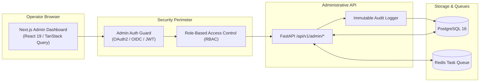

# Internal Admin Dashboard Specification

**Document Version:** 1.0.0  
**Phase:** Phase 0 (Planning & Architecture)  
**Status:** Approved for Architectural Baseline  

---

## 1. Dashboard Architecture & Purpose

The Internal Admin Dashboard is a secure operational backplane built with **Next.js (App Router), TypeScript, and Tailwind CSS / Shadcn UI**. It connects to the backend via a dedicated, authenticated `/api/v1/admin` REST interface.

### The Zero-Manual-DB-Edits Mandate
Operational staff, support agents, and astrological reviewers must **never execute raw SQL queries or manual database edits** during day-to-day operations. Every administrative capability—such as retrying failed horoscope dispatches, inspecting LLM conversation traces, managing user preferences, or executing compliance data deletions—is provided as a secure, audited dashboard action.



---

## 2. Roles & Permissions Matrix (RBAC)

| Role | Responsibilities | Permissions |
| :--- | :--- | :--- |
| **Super Admin** | Platform governance, infrastructure, compliance | Full read/write across all screens, user deletion, configuration updates, role assignment. |
| **Support Specialist** | Customer inquiry resolution, delivery troubleshooting | Read-only conversation inspector, re-queue failed messages, view delivery status. PII phone numbers are masked. |
| **Astrology QA Lead** | Quality audit of calculations and interpretations | Deep inspection of calculation JSON vs LLM interpretation, flagging hallucinations, managing prompt templates. |
| **Compliance Officer** | Privacy audits, GDPR/DPDP requests | Audit log access, consent verification, executing and verifying user erasure requests. |

---

## 3. Screen Specifications

### Screen 1: System Health & Executive Overview
- **Header:** Live status badge (`Operational`, `Degraded`, `Outage`), active server region, time-to-last-webhook.
- **Top Metrics Row:**
  - `Inbound Throughput:` Messages/sec (live 60s sparkline).
  - `Webhook Response Latency:` 95th percentile (target $< 500\text{ms}$).
  - `LLM Token Burn & Cost:` Daily and monthly cumulative token cost.
  - `Calculation Success Rate:` Percentage of error-free Swiss Ephemeris executions (target $> 99.99\%$).
  - `Queue Depth:` Active Redis jobs across `whatsapp_inbound`, `astro_calc`, and `horoscope_scheduled`.
- **System Service Status Table:**
  - Meta WhatsApp Webhook Gateway (Healthy / Errors)
  - Redis Task Broker (Connected, Memory % utilized)
  - PostgreSQL Database (Connection pool stats, read/write latency)
  - Geocoding Service (API quotas remaining, cache hit ratio)
  - LLM Provider Gateways (Primary vs Fallback status)

---

### Screen 2: Conversation Inspector & Trace Viewer
The primary diagnostic screen for evaluating agent behavior, calculation fidelity, and user experience.

```
+---------------------------------------------------------------------------------------------------+
| CONVERSATION INSPECTOR                                     [ Search phone hash / wamid / date... ] |
+---------------------------------------------------------------------------------------------------+
| FILTERS: System: [ All v ] | Language: [ All v ] | Intent: [ All v ] | Has Error: [ Yes/No ]       |
+---------------------------------------------------------------------------------------------------+
| TIME         | USER HASH   | LANG | INTENT          | TOOL CALLED            | LATENCY | STATUS  |
| 18:04:12 UTC | e4a8...91b2 | hi   | ask_horoscope   | calculate_natal_chart  | 2,410ms | SUCCESS |
| 18:02:45 UTC | 12c9...fe30 | en   | compatibility   | calculate_compat       | 3,890ms | SUCCESS |
| 17:58:10 UTC | 98df...33aa | es   | transit_query   | calculate_transits     | 1,940ms | SUCCESS |
+---------------------------------------------------------------------------------------------------+
```

#### Detailed Message Trace Modal (Side-by-Side Verification):
When clicking any conversation row, a side-by-side trace drawer opens:
1. **User Message:** Raw text received from WhatsApp, timestamp, and detected language (`hi-Latn` / Hinglish).
2. **Intent & Slots:** Extracted intent (`transit_query`), entity slots extracted (`target_planet: "Saturn"`).
3. **Verified Calculation JSON:** The exact output from Swiss Ephemeris:
   ```json
   {
     "system": "vedic",
     "ayanamsa": "lahiri",
     "natal_moon_sign": "Scorpio",
     "transiting_saturn_sign": "Aquarius",
     "house_transited": 4,
     "sade_sati_status": "inactive"
   }
   ```
4. **LLM Prompt & Outbound Synthesis:** The exact system/user prompt sent to the model and the returned markdown response.
5. **Auditor Action:** A "Flag for Review" button enabling the Astrology QA team to flag any discrepancy between calculation and prose.

---

### Screen 3: User & Birth Profile Management
- **Search:** Search by anonymized phone hash or last 4 digits of phone number.
- **Profile Detail View:**
  - Consent status: Version signed, timestamp, IP/Channel.
  - Active Astrology System: Toggle between `Vedic` and `Western` directly from UI.
  - Birth Profile Details: Birth date, time (or `UNKNOWN`), resolved location coordinates, timezone.
  - Subscription status: Active daily horoscope delivery time.
- **Actions:**
  - `Trigger Test Message:` Sends a diagnostic test message to verify connectivity.
  - `Reset Conversation State:` Clears stuck conversational slots without deleting profile.
  - `Execute Full Data Erasure:` Triggers atomic GDPR/DPDP cascading deletion with confirmation modal.

---

### Screen 4: Scheduled Horoscope & Delivery Monitor
- **Scheduled Pipeline Funnel:**
  - Scheduled for Today: e.g., $12,450$ users.
  - Dispatched: $11,920$ ($95.7\%$).
  - Delivered: $11,850$ ($99.4\%$).
  - Read: $8,420$ ($71.0\%$).
  - Failed: $58$ ($0.5\%$).
- **Timezone Wave Visualizer:** Heatmap showing deliveries progressing through global time zones (UTC+12 down to UTC-10) at 08:00 AM local time.
- **Failures Table:** Lists failed deliveries with Meta error code (`131026: Message undeliverable`, `130472: User out of 24h window and no template approved`).
- **Actions:** `Bulk Retry Failed Deliveries` button.

---

### Screen 5: Operational Errors & Dead-Letter Queue (DLQ)
- **Error Feed:** Filterable by component (`Webhook Ingress`, `Calculation Engine`, `LLM Gateway`, `Delivery Worker`).
- **Stack Trace Inspector:** Full Python traceback with environment variables and PII stripped.
- **One-Click Remediation Actions:**
  - `Retry Job Now:` Re-inserts failed payload into active Redis queue.
  - `Discard Job:` Marks job as permanently discarded with operator notes.
  - `Export Error Report:` Generates a sanitized JSON export for engineering analysis.

---

### Screen 6: Astrological QA & Feedback Review
- **Feedback Feed:** Displays end-user ratings (1 to 5 stars) and conversational feedback.
- **Tag Breakdown:** Visual bar chart of user feedback tags (`Accurate`, `Insightful`, `Confusing Language`, `Factually Incorrect`).
- **QA Verification Benchmarking:** Enables internal astrologers to review 50 random daily interpretations per week, rating them on a 3-point scale: *Faithful to Calculation*, *Minor Hallucination*, *Severe Hallucination*.

---

### Screen 7: Immutable Audit Log
- **Columns:** Timestamp, Actor ID, Actor Role, Action (`USER_PREFERENCE_UPDATE`, `MANUAL_JOB_RETRY`, `DATA_ERASURE_EXECUTED`), Target Entity, IP Address.
- **Integrity:** Write-only table; updates and deletes are prevented at PostgreSQL database level via trigger. Searchable and exportable to CSV/JSON for compliance audits.
