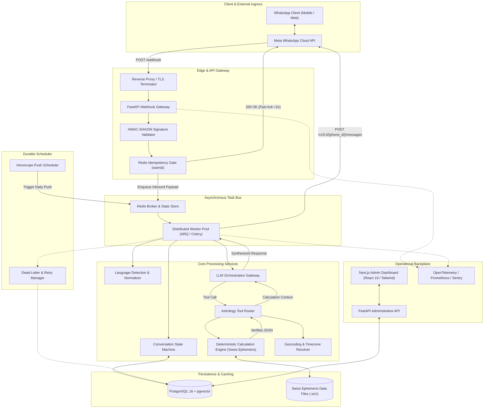
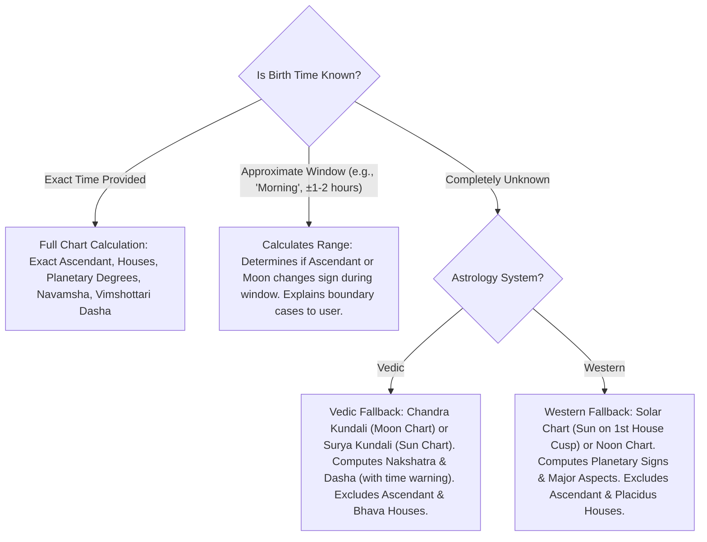

# System Architecture Specification — Astrology WhatsApp AI Platform

**Document Version:** 1.0.0  
**Phase:** Phase 0 (Planning & Architecture)  
**Status:** Approved for Architectural Baseline  

---

## 1. High-Level Architectural Topology

The Astrology WhatsApp AI Platform is engineered as an asynchronous, event-driven, decoupled system. The architecture guarantees sub-second webhook acknowledgments, strictly deterministic astrological calculations, model-agnostic LLM orchestration, durable background scheduling, and end-to-end operational observability.



---

## 2. Component Responsibilities

### 2.1 Ingress Layer (FastAPI Gateway)
- **Role:** Webhook receiving, authentication, validation, and fast response.
- **Responsibilities:**
  - Validates `X-Hub-Signature-256` header against `META_APP_SECRET`.
  - Performs webhook verification challenge (`hub.mode=subscribe` and `hub.challenge`).
  - Checks message uniqueness via `wamid` (WhatsApp Message ID) against Redis cache with a 24-hour TTL.
  - Acknowledges webhook with HTTP `200 OK` in `< 500ms` (well below Meta's 15s timeout) to prevent duplicate webhook delivery.
  - Enqueues inbound messages into the Redis task broker.

### 2.2 Task Broker & Asynchronous Worker Pool (Redis + ARQ/Celery)
- **Role:** Decouples message ingestion from computation and LLM latency.
- **Responsibilities:**
  - Ingestion queue (`whatsapp_inbound`): Handles user messages and delivery notifications.
  - High-priority calculation queue (`astro_calculations`): Dedicated to ephemeral chart computations.
  - Outbound messaging queue (`whatsapp_outbound`): Manages rate-limited sends to Meta Graph API.
  - Scheduled queue (`horoscope_scheduled`): Handles recurring daily push notifications.
  - Manages exponential backoff retries and Dead-Letter Queues (DLQ).

### 2.3 Conversation State Machine & Memory Manager
- **Role:** Tracks conversational state, intent context, and slot extraction.
- **Responsibilities:**
  - Maintains conversation turn history in PostgreSQL (last $N$ interactions).
  - Tracks user onboarding state (`NEW`, `CONSENT_PENDING`, `SYSTEM_SELECTION`, `BIRTH_DATA_COLLECTION`, `READY`).
  - Manages sub-states (e.g., waiting for partner birth details during compatibility matching).
  - Handles explicit commands (`SWITCH_SYSTEM`, `RESET`, `DELETE_DATA`, `HELP`).

### 2.4 Language Detection & Dialect Normalizer
- **Role:** Dynamic language adaptation and code-switching handling.
- **Responsibilities:**
  - Detects language of inbound messages using lightweight local classifier (e.g., `fasttext` / `langdetect`) combined with LLM context awareness.
  - Supports English, Hindi, Hinglish, Spanish, French, German, and Portuguese.
  - Respects persistent user language override in `user_preferences`.
  - Injects target language and dialect instructions into the prompt context for LLM generation.

### 2.5 Deterministic Astrological Engine
- **Role:** Exact mathematical and astronomical computation.
- **Responsibilities:**
  - Wrapper around Swiss Ephemeris (`pyswisseph`) compiled with high-precision ephemeris files (`.se1` files covering 1800–2100 CE).
  - Computes topocentric and geocentric planetary longitudes, latitudes, speeds, house cusps, and ascendants.
  - Separate engine configuration for **Vedic** and **Western** traditions.
  - **Zero LLM Calculation Rule:** LLM never performs mathematical or coordinate calculations. Outputs are returned as strict, typed Pydantic models.

### 2.6 Geocoding & Timezone Resolution Service
- **Role:** Converts human-entered place names into geographic coordinates and exact historical local time offsets.
- **Responsibilities:**
  - Resolves location name to Latitude, Longitude, and Elevation using Geonames/Photon with Google Maps Geocoding fallback.
  - Resolves historical timezone using `timezonefinder` and IANA `zoneinfo`.
  - Evaluates historical Daylight Saving Time (DST) and wartime shifts for the exact birth moment.

### 2.7 LLM Orchestration Gateway
- **Role:** Semantic intent classification, slot extraction, tool calling, and interpretation synthesis.
- **Responsibilities:**
  - Provider-agnostic gateway interface (supporting Gemini, Anthropic Claude, and OpenAI via a unified client).
  - Uses structured JSON outputs (`tools` / `function_calling`) to invoke astrology skills.
  - Takes raw verified calculation JSON and transforms it into empathetic, personalized, culturally nuanced natural language.
  - Adheres to astrological traditions (e.g., Vedic interpretations utilize Jyotish terms like *Graha*, *Rashi*, *Bhava*, *Nakshatra*; Western uses *Planets*, *Signs*, *Houses*, *Aspects*).

### 2.8 Database & Persistence (PostgreSQL 16 + pgvector)
- **Role:** Source of truth for relational state and semantic reference documents.
- **Responsibilities:**
  - Relational tables for users, birth profiles, consent logs, subscriptions, and audit trails.
  - Encrypted storage of sensitive fields.
  - `pgvector` extension for storing curated astrological interpretations and reference texts for retrieval-augmented generation (RAG).

### 2.9 Next.js Admin Dashboard
- **Role:** Operational visibility, conversation inspection, and system administration.
- **Responsibilities:**
  - Live conversation inspector showing end-to-end trace: Inbound Message -> Extracted Intent -> Tool Parameters -> Engine Output JSON -> Outbound LLM Prompt -> Generated Message.
  - Real-time operational metrics: Webhook latency, token consumption, calculation errors, queue depth.
  - User management, privacy deletion execution, and schedule monitoring.

---

## 3. End-to-End Message Processing Lifecycle

```
User (WhatsApp)          Meta Cloud API         FastAPI Ingress        Redis Broker        Worker / LLM        Astro Engine
      |                        |                       |                     |                   |                   |
      |-- 1. Send Message ---->|                       |                     |                   |                   |
      |                        |-- 2. Webhook Event -->|                     |                   |                   |
      |                        |                       |-- 3. Verify HMAC -->|                   |                   |
      |                        |                       |-- 4. Check Idemp. ->|                   |                   |
      |                        |<- 5. 200 OK (Ack) ----|                     |                   |                   |
      |                        |                       |-- 6. Enqueue Job -->|                   |                   |
      |                        |                       |                     |-- 7. Pop Task --->|                   |
      |                        |                       |                     |                   |-- 8. Fetch State -|-> Postgres
      |                        |                       |                     |                   |-- 9. Detect Lang -|
      |                        |                       |                     |                   |-- 10. Intent/Tool |
      |                        |                       |                     |                   |-- 11. Run Calc -->|
      |                        |                       |                     |                   |<- 12. Valid JSON -|
      |                        |                       |                     |                   |-- 13. Synth Prose |
      |                        |                       |                     |                   |-- 14. Save Record |-> Postgres
      |<-- 16. Delivered Msg --|<- 15. Send Message ---|---------------------|-------------------|
```

### Step-by-Step Execution Sequence
1. **Webhook Ingress:** Meta sends HTTP `POST` to `/api/v1/webhook/whatsapp`.
2. **Security & Validation:** FastAPI verifies HMAC SHA-256 signature using `X-Hub-Signature-256` header.
3. **Idempotency Gate:** System extracts `wamid` from message payload. Executes atomic `SETNX whatsapp:msg:{wamid} 1 EX 86400` in Redis. If key exists, immediately returns `200 OK` (duplicate ignored).
4. **Fast Acknowledgment:** Returns HTTP `200 OK` to Meta within `< 500ms`.
5. **Job Enqueuing:** Webhook payload is serialized and pushed to `whatsapp_inbound` Redis stream.
6. **Worker Intake:** Worker deserializes payload, extracts phone number, sender name, message body, and message type (text, button_reply, interactive_list).
7. **User Context Lookup:** Retrieves user record, active profile, privacy consent status, and recent conversation turns from PostgreSQL.
8. **State Routing:**
   - If user is in onboarding flow: routes to Onboarding State Handler.
   - If user triggers an administrative command ("DELETE", "SWITCH"): routes to Command Handler.
   - Otherwise: routes to LLM Intent & Tool Router.
9. **Intent Classification & Tool Selection:**
   - LLM receives system prompt + user profile + current query.
   - LLM selects tool (`calculate_natal_chart`, `calculate_daily_horoscope`, `calculate_compatibility`, `calculate_transits`, or `general_conversation`).
10. **Deterministic Calculation:**
    - Tool router invokes Swiss Ephemeris engine with validated geographic coordinates and UTC timestamp.
    - Engine computes planetary positions, houses, aspects, and dashas.
    - Engine returns immutable, strictly typed calculation model.
11. **Interpretation Synthesis:**
    - LLM receives second-pass prompt: user query, detected language/tone, astrological tradition rules, and verified calculation JSON.
    - LLM produces concise, empathetic, WhatsApp-formatted Markdown response.
12. **Outbound Dispatch:**
    - Response is chunked if it exceeds 4,096 characters (WhatsApp limit; best practice is `< 1,000` chars per bubble).
    - Sent via Meta Graph API `POST /v19.0/{phone_number_id}/messages`.
    - Message trace and tokens recorded in PostgreSQL.

---

## 4. Separation of Calculation and Interpretation

To maintain scientific integrity and prevent astrological hallucinations:

```
+-----------------------------------------------------------------------------------------+
|                               VERIFICATION FIREWALL                                     |
+------------------------------------+----------------------------------------------------+
|  DETERMINISTIC ENGINE (UNTOUCHED)  |         LLM INTERPRETATION (CONTROLLED)            |
+------------------------------------+----------------------------------------------------+
| - Calculates exact ephemeris lines | - Explains what planetary combinations mean        |
| - Computes true sidereal/tropical  | - Synthesizes insights into natural conversational |
|   degrees, minutes, seconds        |   prose in user's detected language/dialect        |
| - Calculates exact House cusps     | - NEVER permitted to output coordinate degrees    |
| - Computes exact Ashtakoota score  |   unless directly present in calculation JSON      |
|   (e.g., 28.5 / 36)                | - Must cite calculation facts verbatim             |
| - Outputs structured JSON schema   | - Constrained by anti-hallucination system prompt  |
+------------------------------------+----------------------------------------------------+
```

### Anti-Hallucination Prompting & Validation Guardrail
1. The deterministic engine produces a signed JSON payload containing `calculation_hash`.
2. The LLM prompt explicitly specifies:
   > "You are an astrological interpreter. You MUST base your interpretation strictly on the calculated planetary placements provided in the JSON context. DO NOT invent, assume, or modify any planetary positions, signs, houses, or scores. If a planetary placement is not in the JSON, state that it is unavailable."
3. **Automated Guardrail Check:** A lightweight post-generation assertion verifies that any mentioned zodiac signs or houses for specific planets match the calculation JSON before dispatching to the user.

---

## 5. Vedic vs. Western Calculation Configurations

| Parameter | Vedic (Jyotish) Configuration | Western (Tropical) Configuration |
| :--- | :--- | :--- |
| **Zodiac Reference** | **Sidereal (Nirayana)**: Accounts for precession of equinoxes. | **Tropical (Sayana)**: Fixed to the Vernal Equinox (0° Aries). |
| **Ayanamsa** | **Lahiri (Chitrapaksha)** default (Swiss Ephemeris `SE_SIDM_LAHIRI`). Optional support for KP and Raman. | Not applicable (Tropical offset = 0.0). |
| **House System** | **Bhava Chalit / Equal House / Sripati** (Sign equals House in traditional Rashi D1; Bhava Chalit for cusp shifts). | **Placidus** default (`SE_HSYS_PLACIDUS`). Optional **Whole Sign** (`SE_HSYS_WHOLESIGN`). |
| **Primary Points** | Sun, Moon, Mars, Mercury, Jupiter, Venus, Saturn, Rahu (North Node), Ketu (South Node), Lagna (Ascendant). | Sun, Moon, Mercury, Venus, Mars, Jupiter, Saturn, Uranus, Neptune, Pluto, Chiron, Ascendant, Midheaven (MC). |
| **Divisional Charts** | **D1 (Rashi)** fundamental; **D9 (Navamsha)** for marriage, inner potential, and planetary dignity. | Not applicable. Uses harmonic charts or decans/terms if requested. |
| **Timing System** | **Vimshottari Dasha** (120-year cycle based on Moon's natal Nakshatra: Mahadasha, Antardasha, Pratyantardasha). | **Transits to Natal** (major aspects of outer planets to natal inner planets), Secondary Progressions. |
| **Aspect System** | **Vedic Graha Drishti**: Special full aspects (Mars 4th/7th/8th, Jupiter 5th/7th/9th, Saturn 3rd/7th/10th, all planets 7th). | **Ptolemaic Aspects**: Conjunction (0°), Sextile (60°), Square (90°), Trine (120°), Opposition (180°) with defined orb limits. |
| **Compatibility** | **Ashtakoota Milan** (36 Gunas based on Janma Nakshatra) + **Manglik Dosha** (Kuja Dosha) analysis. | **Synastry Aspects**: Cross-aspects between charts (Sun-Moon, Venus-Mars), Synastry house overlays, Element balance. |

---

## 6. Time Zones, Geocoding, and Birth-Time Uncertainty

### 6.1 Geographic Location & Historical Timezone Resolution
1. **Input Normalization:** Place names (e.g., "Delhi", "New York", "San Pedro Sula") are resolved using an offline gazetteer cache (`geonamescache`) followed by Photon/OSM and Google Maps Geocoding API fallback.
2. **Coordinate Precision:** Coordinates are stored as `latitude` and `longitude` rounded to 4 decimal places (accuracy ~11 meters), sufficient for astronomical house cusp calculations.
3. **Historical Timezone Offset:** The system looks up the IANA timezone identifier (e.g., `Asia/Kolkata`, `America/New_York`) via `timezonefinder`. Python's `zoneinfo` computes the exact historical UTC offset for the given date, accounting for historical Daylight Saving Time shifts, local mean time variations before national standardizations, and wartime offsets.

### 6.2 Handling Birth-Time Uncertainty
Birth time accuracy is critical for Ascendant (Lagna) and House cusps (the Ascendant moves ~1° every 4 minutes).



The system automatically appends an informational disclaimer to the interpretation:
> *"Note: Because your exact birth time was not provided, this reading uses a Moon/Solar chart. Planetary signs and major aspects are accurate, but Rising Sign (Ascendant) and specific house placements require an exact birth time."*

---

## 7. Reliability, Observability & Error Handling

### 7.1 Idempotency & Duplicate Suppression
Meta's WhatsApp webhook engine guarantees at-least-once delivery. If Meta does not receive a response within 15 seconds, it retries delivery up to 7 times.
- **Deduplication Strategy:** The message unique identifier `wamid` is stored in Redis using `SETNX` with a 24-hour expiration before any business logic executes.
- **Database Level:** Unique constraint on `messages(wamid)`. Duplicate webhooks are acknowledged immediately with HTTP 200 and discarded.

### 7.2 Rate Limiting & Abuse Prevention
- **Inbound Webhook Rate Limiting:** Enforced via Redis sliding-window counter. Max 10 messages per minute per phone number. Excessive messages trigger a courteous rate-limit response: *"I'm working on your previous request. Please give me a moment before sending more messages."*
- **Outbound Meta API Throttling:** Token bucket algorithm ensuring Meta Cloud API rate limits (80 messages/second per phone number id) are never exceeded.

### 7.3 Timeouts & Circuit Breakers
- **Swiss Ephemeris Calculation:** Synchronous in-memory computation, typical execution time `< 5ms`. Hard timeout: `500ms`.
- **Geocoding API:** HTTP timeout `2.5s`. Caches successful lookups indefinitely in Redis/Postgres.
- **LLM Gateway:** HTTP timeout `8.0s`. If the primary LLM provider times out or fails (HTTP 500/529), an automatic fallback router invokes a secondary provider (e.g., Primary: Claude 3.5 Sonnet -> Secondary: GPT-4o-mini).

### 7.4 Dead-Letter Queue (DLQ) & Failed Job Recovery
- Any background worker failure (e.g., external API network disconnect, unexpected syntax error) retries 3 times with exponential backoff (`delay = 2^attempt * 500ms`).
- After 3 failed attempts, the job payload, exception stack trace, and context are moved to `dlq_jobs` in PostgreSQL and flagged on the Admin Dashboard with an active alert.
- The user receives an empathetic WhatsApp fallback message:
  > *"I encountered an unexpected glitch while calculating your astrological details. Our technical team has been notified, and we'll be ready for you shortly. Please try asking again in a few minutes."*

### 7.5 Observability Stack
- **Structured JSON Logging:** All application events logged in JSON format with `correlation_id`, `user_id_hash`, `wamid`, and `latency_ms`.
- **Prometheus Metrics:**
  - `whatsapp_inbound_webhooks_total` (labels: status, type)
  - `astro_calculation_duration_seconds` (histogram)
  - `llm_request_duration_seconds` (histogram, labels: provider, model)
  - `active_user_sessions_gauge`
  - `dlq_failures_total`
- **Sentry Integration:** Captures unhandled exceptions with sanitized contexts (PII and birth dates stripped).
