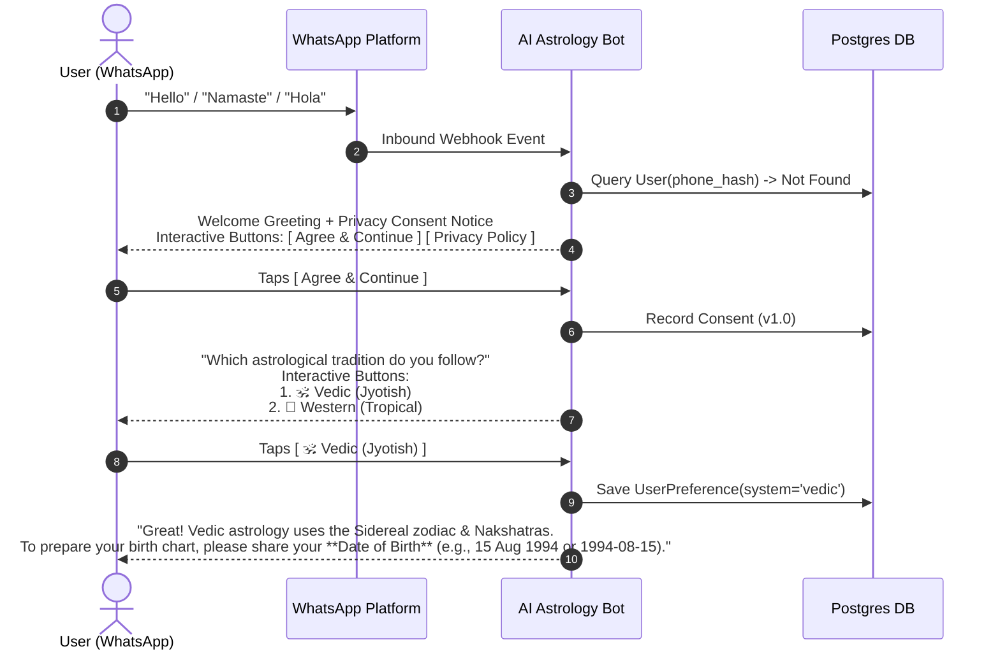
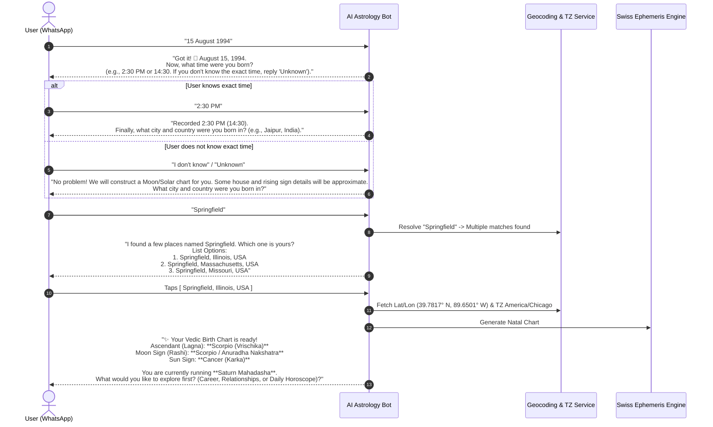
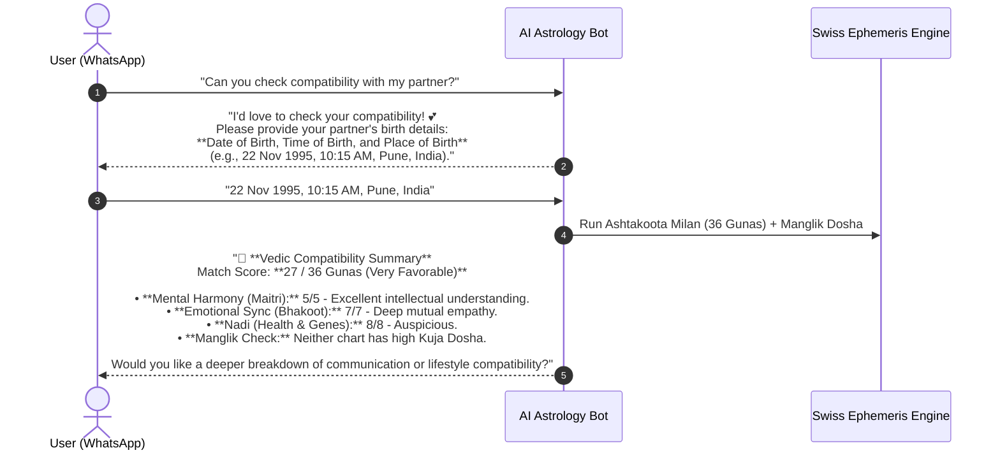
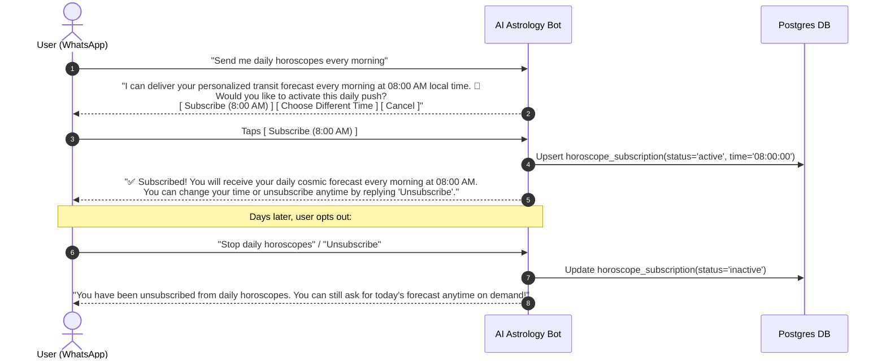
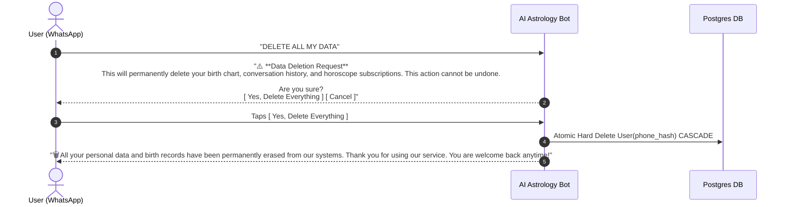

# WhatsApp Conversation Design & Interaction Flows

**Document Version:** 1.0.0  
**Phase:** Phase 0 (Planning & Architecture)  
**Status:** Approved for Architectural Baseline  

---

## 1. Conversational Principles & Persona

1. **Empathetic & Grounded:** The assistant acts as an insightful, culturally knowledgeable guide rather than a deterministic robot or a fatalistic fortune teller.
2. **Deterministic Transparency:** Astrological claims are framed constructively (strengths, energetic tendencies, opportunities, cautions) rather than fatalistic decrees ("You will lose your job tomorrow").
3. **Frictionless Onboarding:** Minimal cognitive load. One question at a time during data collection.
4. **Natural Code-Switching:** Seamless adaptation to user language, colloquialisms, and mixed dialects (e.g., Hinglish: "Mera career kaisa rahega?").
5. **Interactive UI Components:** Leverages native WhatsApp interactive components (Quick-Reply Buttons and List Messages) whenever choices are finite to reduce typing errors.

---

## 2. WhatsApp Messaging Policies & Compliance

### 2.1 The 24-Hour Customer Service Window
- **User-Initiated Sessions:** When a user messages the business, a 24-hour service window opens. Inside this window, the platform can send free-form text, images, and interactive messages without Meta template pre-approval.
- **Business-Initiated Messages (Scheduled Horoscopes):** Outside the 24-hour window, WhatsApp **strictly forbids** free-form messaging. All scheduled morning horoscopes sent after 24 hours of inactivity **MUST use a pre-approved Meta Message Template** (categorized as *Utility* or *Marketing*).

### 2.2 Template Strategy for Scheduled Horoscopes
To deliver daily horoscopes reliably without violating Meta policies:
1. **Template Name:** `daily_horoscope_update`
2. **Category:** `UTILITY` (if framed as a requested account alert) or `MARKETING` (depending on Meta country policy).
3. **Template Format:**
   ```
   Good morning, {{1}}! 🌅
   Here is your daily astrological transit overview for {{2}}:

   {{3}}

   Reply to explore today's transits or ask any question.
   ```
4. Once the user replies to this template, a fresh 24-hour free-form messaging window opens, enabling deep conversational follow-ups.

---

## 3. Core Conversation Flows

### Flow 1: New User Onboarding & System Selection



---

### Flow 2: Birth Data Collection & Disambiguation



---

### Flow 3: Returning User & Contextual Conversations

Returning users bypass onboarding and can converse freely:
- **User:** *"How is my career looking for the rest of this year?"*
- **Bot:**
  1. Checks active profile (`Self`, Vedic, Scorpio Lagna).
  2. Runs transit query: Saturn transiting 4th house (Aquarius) aspecting 10th house of career (Leo); Jupiter transiting 7th house (Taurus) aspecting 10th and Lagna.
  3. LLM synthesizes response in user's preferred language:
  > *"Based on your Vedic chart (Scorpio Lagna), you are experiencing a pivotal career phase. Saturn's aspect on your 10th house (Leo) demands disciplined effort and patience, while Jupiter's benefic aspect from Taurus indicates recognition from superiors and opportunities for expansion starting next quarter. Focus on long-term stability rather than impulsive job changes."*

---

### Flow 4: Compatibility Matching Workflow



---

### Flow 5: Daily Horoscope Subscription & Opt-Out



---

### Flow 6: Preference Switching (Vedic <-> Western)

- **User:** *"I want to switch to Western astrology."*
- **Bot:**
  > *"Switching your profile to **Western (Tropical) Astrology**! 🌌\n\nIn Western astrology, your Sun sign is **Leo**, your Moon is in **Sagittarius**, and your Rising Sign (Ascendant) is **Sagittarius** (using Placidus houses).\n\nFuture queries, daily transits, and compatibility will now follow Western astrology principles. You can switch back anytime by saying 'Switch to Vedic'."*

---

### Flow 7: Data Deletion & Privacy Erasure



---

## 4. Multilingual & Code-Switching Handling

### Dialect Support Matrix
| Input Style | User Message Example | Bot Response Language & Strategy |
| :--- | :--- | :--- |
| **Pure English** | "What does today look like for my finances?" | Standard English, empathetic, precise astrological terminology. |
| **Pure Hindi (Devanagari)** | "मेरी कुंडली में सरकारी नौकरी का योग कब बन रहा है?" | Natural Hindi in Devanagari script; standard Jyotish terms (सूर्य, दशम भाव, दशा). |
| **Hinglish (Romanized)** | "Bhai, mera Shani dasha kab khatam hoga? Bahut tension hai." | Natural Hinglish conversational tone: empathetic, reassuring, culturally relatable phrasing. |
| **Spanish** | "¿Cómo influye el tránsito de Marte en mi signo hoy?" | Fluent Spanish, Western astrological concepts (Marte, Casa, Tránsitos). |
| **French / German** | "Quel est mon signe lunaire et ascendant ?" | Fluent French / German with corresponding cultural terminology. |

### Code-Switching Continuity Rule
If a user begins in English and suddenly sends a message in Hindi or Spanish, the bot **immediately switches** to reply in that language for that turn and continues in that language until the user switches again. Users can also issue an explicit command at any time: *"Please reply in English only"*.
