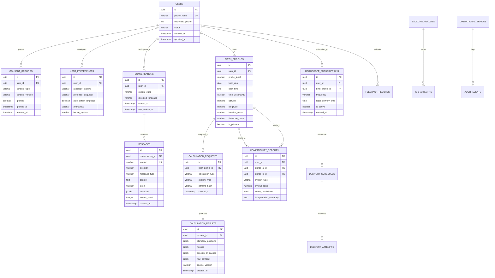

# Data Model & Privacy Architecture — Astrology WhatsApp AI Platform

**Document Version:** 1.1.0  
**Phase:** Phase 2 (Persistence Layer, Data Models & Privacy Architecture Implemented)  
**Status:** Core Schema & Field-Level Encryption Active  

---

## 1. Data Philosophy & Privacy-by-Design

Astrological consultation requires sensitive personal information: exact dates, times, and places of birth, combined with deeply personal conversational topics (relationships, career, health, finances).

The platform adheres to strict Privacy-by-Design principles under **GDPR (General Data Protection Regulation)** and **India DPDP Act (Digital Personal Data Protection Act 2023)**:
1. **Data Minimization:** We do not collect real names, email addresses, or physical addresses. The WhatsApp Phone Number is cryptographically pseudonymized (HMAC-SHA256 with a secret salt) for identification and analytics, with the raw E.164 phone number stored only in an encrypted column required for message delivery.
2. **Explicit Consent & Versioning:** No birth details or conversation logs are stored until the user provides affirmative consent. Consent records are immutably versioned.
3. **Right to Erasure (Instant Deletion):** When a user requests data deletion, a cascading wipe destroys all birth profiles, conversation turns, calculation results, and subscriptions within 60 seconds.
4. **Field-Level Encryption:** Sensitive birth coordinates and raw message contents are encrypted at rest using AES-256-GCM (application-level envelope encryption via AWS KMS / GCP Cloud KMS / Vault).

---

## 2. Entity-Relationship Diagram



---

## 3. Relational Database Schema (PostgreSQL 16 DDL)

```sql
-- Enable necessary extensions
CREATE EXTENSION IF NOT EXISTS "uuid-ossp";
CREATE EXTENSION IF NOT EXISTS "pgcrypto";
CREATE EXTENSION IF NOT EXISTS "vector";

-- ============================================================================
-- 1. USERS & PRIVACY CONSENT
-- ============================================================================

CREATE TYPE user_status_enum AS ENUM ('active', 'suspended', 'deleted', 'anonymized');
CREATE TYPE astrology_system_enum AS ENUM ('vedic', 'western');
CREATE TYPE time_uncertainty_enum AS ENUM ('exact', 'approximate_window', 'unknown');

CREATE TABLE users (
    id UUID PRIMARY KEY DEFAULT uuid_generate_v4(),
    phone_hash VARCHAR(64) NOT NULL UNIQUE, -- SHA-256(phone + salt) for indexing & lookups
    encrypted_phone TEXT NOT NULL,          -- AES-256-GCM encrypted E.164 phone number
    whatsapp_name VARCHAR(255),             -- WhatsApp profile display name
    status user_status_enum NOT NULL DEFAULT 'active',
    created_at TIMESTAMPTZ NOT NULL DEFAULT CURRENT_TIMESTAMP,
    updated_at TIMESTAMPTZ NOT NULL DEFAULT CURRENT_TIMESTAMP,
    deleted_at TIMESTAMPTZ
);

CREATE INDEX idx_users_phone_hash ON users(phone_hash);
CREATE INDEX idx_users_status ON users(status);

CREATE TABLE consent_records (
    id UUID PRIMARY KEY DEFAULT uuid_generate_v4(),
    user_id UUID NOT NULL REFERENCES users(id) ON DELETE CASCADE,
    consent_type VARCHAR(64) NOT NULL,      -- e.g., 'privacy_policy', 'birth_data_processing'
    consent_version VARCHAR(32) NOT NULL,   -- e.g., 'v1.0_2026'
    granted BOOLEAN NOT NULL DEFAULT TRUE,
    granted_at TIMESTAMPTZ NOT NULL DEFAULT CURRENT_TIMESTAMP,
    revoked_at TIMESTAMPTZ,
    channel VARCHAR(32) NOT NULL DEFAULT 'whatsapp'
);

CREATE INDEX idx_consent_user ON consent_records(user_id);

CREATE TABLE user_preferences (
    id UUID PRIMARY KEY DEFAULT uuid_generate_v4(),
    user_id UUID NOT NULL UNIQUE REFERENCES users(id) ON DELETE CASCADE,
    astrology_system astrology_system_enum NOT NULL DEFAULT 'vedic',
    preferred_language VARCHAR(10) NOT NULL DEFAULT 'en', -- IETF language tag (e.g., 'en', 'hi', 'es')
    auto_detect_language BOOLEAN NOT NULL DEFAULT TRUE,
    ayanamsa VARCHAR(32) NOT NULL DEFAULT 'lahiri',        -- 'lahiri', 'kp', 'raman'
    house_system VARCHAR(32) NOT NULL DEFAULT 'placidus',  -- 'placidus', 'whole_sign', 'equal'
    updated_at TIMESTAMPTZ NOT NULL DEFAULT CURRENT_TIMESTAMP
);

-- ============================================================================
-- 2. BIRTH PROFILES
-- ============================================================================

CREATE TABLE birth_profiles (
    id UUID PRIMARY KEY DEFAULT uuid_generate_v4(),
    user_id UUID NOT NULL REFERENCES users(id) ON DELETE CASCADE,
    profile_label VARCHAR(64) NOT NULL DEFAULT 'Self', -- 'Self', 'Partner', 'Child', 'Friend'
    is_primary BOOLEAN NOT NULL DEFAULT TRUE,
    birth_date DATE NOT NULL,
    birth_time TIME,                                   -- NULL if completely unknown
    time_uncertainty time_uncertainty_enum NOT NULL DEFAULT 'exact',
    latitude NUMERIC(8, 4) NOT NULL,
    longitude NUMERIC(8, 4) NOT NULL,
    elevation_meters NUMERIC(6, 1) DEFAULT 0.0,
    location_name VARCHAR(255) NOT NULL,              -- e.g., 'Mumbai, Maharashtra, India'
    timezone_name VARCHAR(64) NOT NULL,               -- e.g., 'Asia/Kolkata'
    utc_offset_seconds INTEGER NOT NULL,              -- Historical offset in seconds for this moment
    created_at TIMESTAMPTZ NOT NULL DEFAULT CURRENT_TIMESTAMP,
    updated_at TIMESTAMPTZ NOT NULL DEFAULT CURRENT_TIMESTAMP
);

CREATE INDEX idx_birth_profiles_user ON birth_profiles(user_id);

-- ============================================================================
-- 3. CONVERSATIONS & MESSAGES
-- ============================================================================

CREATE TABLE conversations (
    id UUID PRIMARY KEY DEFAULT uuid_generate_v4(),
    user_id UUID NOT NULL REFERENCES users(id) ON DELETE CASCADE,
    current_state VARCHAR(64) NOT NULL DEFAULT 'READY', -- FSM state
    state_context JSONB NOT NULL DEFAULT '{}'::jsonb,   -- Transient slots (e.g. pending partner input)
    detected_language VARCHAR(10) DEFAULT 'en',
    started_at TIMESTAMPTZ NOT NULL DEFAULT CURRENT_TIMESTAMP,
    last_activity_at TIMESTAMPTZ NOT NULL DEFAULT CURRENT_TIMESTAMP
);

CREATE INDEX idx_conversations_user ON conversations(user_id);
CREATE INDEX idx_conversations_activity ON conversations(last_activity_at);

CREATE TABLE messages (
    id UUID PRIMARY KEY DEFAULT uuid_generate_v4(),
    conversation_id UUID NOT NULL REFERENCES conversations(id) ON DELETE CASCADE,
    wamid VARCHAR(128) UNIQUE,                          -- Meta WhatsApp Message ID (idempotency key)
    direction VARCHAR(8) NOT NULL CHECK (direction IN ('inbound', 'outbound')),
    message_type VARCHAR(32) NOT NULL DEFAULT 'text',   -- 'text', 'interactive_button', 'interactive_list', 'image'
    content TEXT NOT NULL,                              -- User message or Assistant output
    detected_language VARCHAR(10),
    intent VARCHAR(64),                                 -- e.g., 'ask_horoscope', 'ask_compatibility'
    tool_invoked VARCHAR(64),                           -- e.g., 'calculate_natal_chart'
    calculation_id UUID,                                -- Reference to calculation_results
    tokens_prompt INTEGER DEFAULT 0,
    tokens_completion INTEGER DEFAULT 0,
    latency_ms INTEGER DEFAULT 0,
    metadata JSONB NOT NULL DEFAULT '{}'::jsonb,        -- Raw Meta payload metadata
    created_at TIMESTAMPTZ NOT NULL DEFAULT CURRENT_TIMESTAMP
);

CREATE INDEX idx_messages_conversation ON messages(conversation_id);
CREATE INDEX idx_messages_wamid ON messages(wamid);
CREATE INDEX idx_messages_created_at ON messages(created_at);

-- ============================================================================
-- 4. DETERMINISTIC CALCULATIONS & COMPATIBILITY
-- ============================================================================

CREATE TABLE calculation_requests (
    id UUID PRIMARY KEY DEFAULT uuid_generate_v4(),
    birth_profile_id UUID NOT NULL REFERENCES birth_profiles(id) ON DELETE CASCADE,
    calculation_type VARCHAR(64) NOT NULL,              -- 'natal_chart', 'transit', 'synastry', 'daily_transit'
    system_type astrology_system_enum NOT NULL,
    params_hash VARCHAR(64) NOT NULL,                   -- Hash of input params for memoization / cache
    target_datetime_utc TIMESTAMPTZ NOT NULL,           -- Target moment (birth time or transit time)
    created_at TIMESTAMPTZ NOT NULL DEFAULT CURRENT_TIMESTAMP
);

CREATE INDEX idx_calc_params_hash ON calculation_requests(params_hash);

CREATE TABLE calculation_results (
    id UUID PRIMARY KEY DEFAULT uuid_generate_v4(),
    request_id UUID NOT NULL UNIQUE REFERENCES calculation_requests(id) ON DELETE CASCADE,
    planetary_positions JSONB NOT NULL,                 -- Longitudes, signs, speeds, nakshatras, retrogrades
    houses JSONB NOT NULL,                              -- 12 House cusps and Ascendant/MC
    aspects_or_dashas JSONB NOT NULL,                   -- Western cross-aspects OR Vedic Vimshottari Dashas
    special_points JSONB DEFAULT '{}'::jsonb,           -- Arabic parts, Upagrahas, etc.
    raw_payload JSONB NOT NULL,                         -- Complete immutable Swiss Ephemeris output
    engine_version VARCHAR(32) NOT NULL,                -- e.g., 'SwissEphem_2.10.03_pyswisseph'
    created_at TIMESTAMPTZ NOT NULL DEFAULT CURRENT_TIMESTAMP
);

CREATE TABLE compatibility_reports (
    id UUID PRIMARY KEY DEFAULT uuid_generate_v4(),
    user_id UUID NOT NULL REFERENCES users(id) ON DELETE CASCADE,
    profile_a_id UUID NOT NULL REFERENCES birth_profiles(id) ON DELETE CASCADE,
    profile_b_id UUID NOT NULL REFERENCES birth_profiles(id) ON DELETE CASCADE,
    system_type astrology_system_enum NOT NULL,
    overall_score NUMERIC(5, 2) NOT NULL,               -- e.g., 28.5 (out of 36) or 82.0%
    score_breakdown JSONB NOT NULL,                     -- Vedic 8 Kootas OR Western Synastry Harmony score
    dosha_analysis JSONB DEFAULT '{}'::jsonb,           -- Manglik Dosha status & mitigations
    interpretation_summary TEXT NOT NULL,
    created_at TIMESTAMPTZ NOT NULL DEFAULT CURRENT_TIMESTAMP
);

-- ============================================================================
-- 5. HOROSCOPE SUBSCRIPTIONS & BACKGROUND DELIVERIES
-- ============================================================================

CREATE TABLE horoscope_subscriptions (
    id UUID PRIMARY KEY DEFAULT uuid_generate_v4(),
    user_id UUID NOT NULL REFERENCES users(id) ON DELETE CASCADE,
    birth_profile_id UUID NOT NULL REFERENCES birth_profiles(id) ON DELETE CASCADE,
    frequency VARCHAR(16) NOT NULL DEFAULT 'daily',     -- 'daily', 'weekly'
    local_delivery_time TIME NOT NULL DEFAULT '08:00:00',
    is_active BOOLEAN NOT NULL DEFAULT TRUE,
    subscribed_at TIMESTAMPTZ NOT NULL DEFAULT CURRENT_TIMESTAMP,
    unsubscribed_at TIMESTAMPTZ,
    last_delivered_at TIMESTAMPTZ
);

CREATE INDEX idx_subscriptions_active ON horoscope_subscriptions(is_active, local_delivery_time);

CREATE TABLE delivery_schedules (
    id UUID PRIMARY KEY DEFAULT uuid_generate_v4(),
    subscription_id UUID NOT NULL REFERENCES horoscope_subscriptions(id) ON DELETE CASCADE,
    scheduled_for_utc TIMESTAMPTZ NOT NULL,
    status VARCHAR(32) NOT NULL DEFAULT 'pending',      -- 'pending', 'processing', 'completed', 'failed', 'cancelled'
    created_at TIMESTAMPTZ NOT NULL DEFAULT CURRENT_TIMESTAMP
);

CREATE INDEX idx_schedules_pending ON delivery_schedules(scheduled_for_utc, status);

CREATE TABLE delivery_attempts (
    id UUID PRIMARY KEY DEFAULT uuid_generate_v4(),
    delivery_schedule_id UUID NOT NULL REFERENCES delivery_schedules(id) ON DELETE CASCADE,
    attempt_number INTEGER NOT NULL DEFAULT 1,
    wamid VARCHAR(128),
    status VARCHAR(32) NOT NULL,                        -- 'sent', 'delivered', 'read', 'failed'
    template_name VARCHAR(64),                          -- WhatsApp business template if >24h window
    error_code VARCHAR(32),
    error_message TEXT,
    attempted_at TIMESTAMPTZ NOT NULL DEFAULT CURRENT_TIMESTAMP
);

-- ============================================================================
-- 6. SYSTEM MONITORING, FEEDBACK & AUDIT LOGS
-- ============================================================================

CREATE TABLE feedback_records (
    id UUID PRIMARY KEY DEFAULT uuid_generate_v4(),
    user_id UUID NOT NULL REFERENCES users(id) ON DELETE CASCADE,
    message_id UUID REFERENCES messages(id) ON DELETE SET NULL,
    rating INTEGER CHECK (rating BETWEEN 1 AND 5),
    feedback_text TEXT,
    tag VARCHAR(64),                                    -- 'accurate', 'confusing', 'wrong_language', 'hallucination'
    created_at TIMESTAMPTZ NOT NULL DEFAULT CURRENT_TIMESTAMP
);

CREATE TABLE operational_errors (
    id UUID PRIMARY KEY DEFAULT uuid_generate_v4(),
    severity VARCHAR(16) NOT NULL,                      -- 'INFO', 'WARNING', 'ERROR', 'CRITICAL'
    component VARCHAR(64) NOT NULL,                     -- 'webhook', 'calculator', 'llm_gateway', 'scheduler'
    error_code VARCHAR(64) NOT NULL,
    error_message TEXT NOT NULL,
    stack_trace TEXT,
    correlation_id VARCHAR(64),
    payload JSONB,
    resolved BOOLEAN NOT NULL DEFAULT FALSE,
    resolved_by VARCHAR(64),
    resolved_at TIMESTAMPTZ,
    created_at TIMESTAMPTZ NOT NULL DEFAULT CURRENT_TIMESTAMP
);

CREATE INDEX idx_operational_errors_unresolved ON operational_errors(resolved, severity);

CREATE TABLE audit_events (
    id UUID PRIMARY KEY DEFAULT uuid_generate_v4(),
    actor_id VARCHAR(64) NOT NULL,                      -- Admin User ID or 'SYSTEM'
    actor_role VARCHAR(32) NOT NULL,                    -- 'admin', 'support', 'system'
    action VARCHAR(64) NOT NULL,                        -- 'USER_DELETION', 'SUBSCRIPTION_CANCEL', 'CONFIG_CHANGE'
    target_entity VARCHAR(64) NOT NULL,                 -- 'user', 'subscription', 'system_setting'
    target_id UUID,
    before_state JSONB,
    after_state JSONB,
    ip_address INET,
    created_at TIMESTAMPTZ NOT NULL DEFAULT CURRENT_TIMESTAMP
);

CREATE INDEX idx_audit_created ON audit_events(created_at);
```

---

## 4. Retention, Deletion, and Access Policies

### 4.1 Data Retention Schedule
- **Active User Data:** Retained for the duration of the user relationship.
- **Message Content:** Retained for 90 days rolling window for conversational context and quality auditing. Messages older than 90 days are automatically pruned by a scheduled database cleanup worker, retaining only anonymized token counts and intent metrics.
- **Ephemeral Calculations:** Raw calculation request/result JSON is retained for 30 days to facilitate fast caching and debugging.
- **Audit Logs:** Retained for 12 months for compliance and security auditing, with all PII scrubbed.

### 4.2 Right-to-be-Forgotten (Data Wipe Protocol)
When a user submits "DELETE MY DATA":
1. Verification step asks the user to confirm via quick-reply `[ Yes, Delete Everything ]`.
2. Upon confirmation, an atomic transaction executes:
   ```sql
   -- Cascading wipe destroys all child records via FOREIGN KEY ON DELETE CASCADE
   DELETE FROM users WHERE phone_hash = :user_phone_hash;
   ```
3. Redis session cache (`whatsapp:session:{phone_hash}`) is purged.
4. An immutable audit record is logged in `audit_events`:
   ```sql
   INSERT INTO audit_events (actor_id, actor_role, action, target_entity, target_id)
   VALUES ('USER_SELF', 'user', 'USER_DATA_ERASURE', 'users', :user_id);
   ```
5. A confirmation message is dispatched to WhatsApp before closing the connection.

### 4.3 Access Controls & Encryption Keys
- **Encryption in Transit:** Strict TLS 1.3 for all ingress (WhatsApp to FastAPI) and internal database traffic.
- **Encryption at Rest:** Full volume encryption (LUKS / AWS EBS Encryption) + Field-Level Envelope Encryption for `encrypted_phone` and `messages.content`.
- **Database Roles & Permissions:**
  - `app_backend`: Read/write access to user tables, cannot drop tables or alter schemas.
  - `admin_dashboard_readonly`: Read-only access to messages and statistics; phone hashes are masked (`+1-***-***-1234`) in the API response.
  - `migrator`: Schema migration role used exclusively in CI/CD pipeline.
